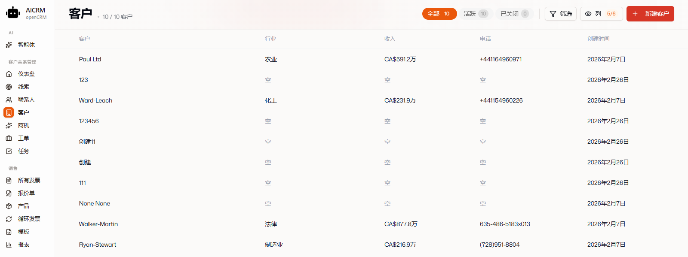
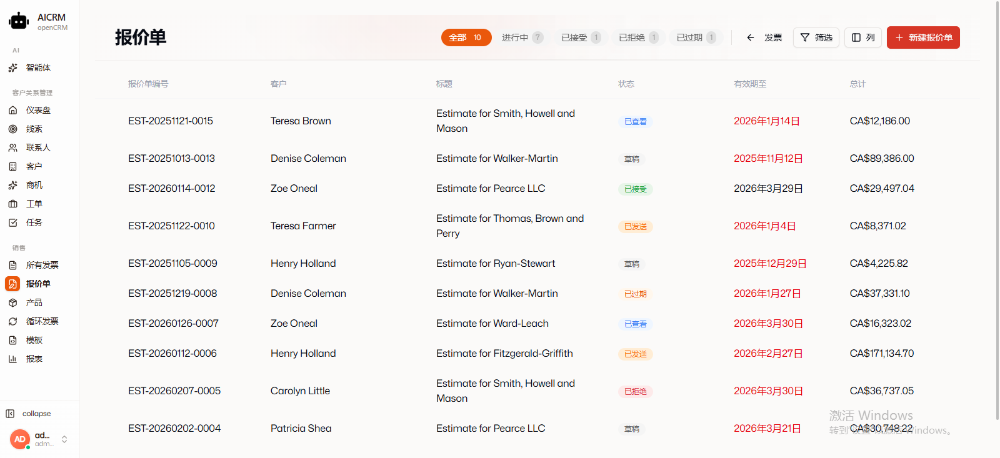
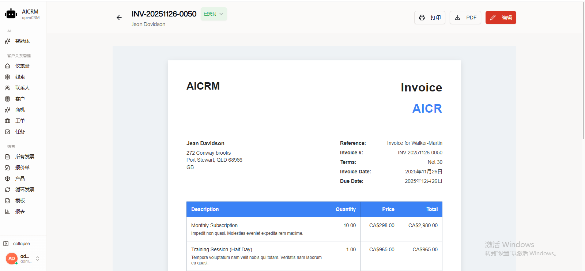
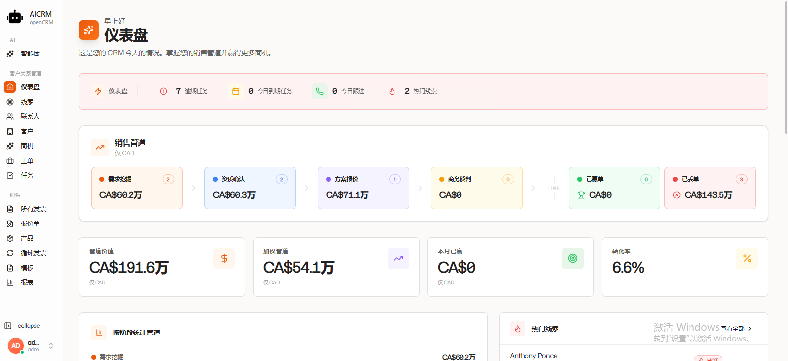
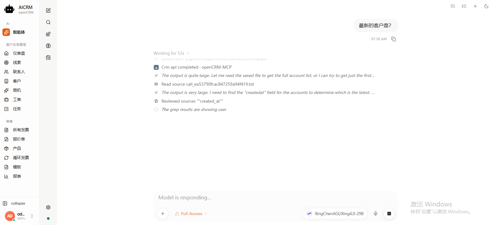

# openCRM

一个现代化的、**AI 智能体驱动**的 CRM 平台，基于 Django REST Framework 和 SvelteKit 构建，无缝集成 nanobot 智能体为客户关系管理注入 AI 能力。

[](#language-switch) [English Version](README.md)


---

## 项目概述

openCRM 是一个功能齐全的客户关系管理系统，专为初创企业和小型企业设计，**核心特色是内置 AI 智能体**。它结合了强大的 Django REST API 后端和现代化的 SvelteKit 前端，采用多租户架构和 PostgreSQL 行级安全性 (RLS) 实现企业级数据隔离，并将 [nanobot](https://github.com/HKUDS/nanobot) 智能体原生嵌入到 CRM 侧边栏的 `/agent` 路由，实现自动化工作流程和智能辅助决策。

## 界面预览

一睹 openCRM 的界面与其内置 AI 智能体的实际效果：

| CRM 管理——线索、客户、联系人等 | 报价单、发票、产品等 |
| :---: | :---: |
|  |  |

| 发票编辑预览 | 系统报表 |
| :---: | :---: |
|  |  |

**AI 智能体问答（含 MCP 工具）**



## AI 智能体集成（核心特色）

openCRM 的 AI 能力来自 [nanobot](https://github.com/HKUDS/nanobot) —— 一个超轻量级（约 4,000 行）的个人 AI 智能体框架。集成方式极简而强大：

- **原生 iframe 嵌入**：nanobot 的 React + TypeScript WebUI 运行在 `8765` 端口，直接作为 iframe 嵌入 CRM 侧边栏的 `/agent` 路由，**无需重写聊天界面**，即可获得完整智能体能力
- **零配置接入**：首次访问 `/agent` 时通过 `bootstrapSecret` 参数完成鉴权，后续鉴权由 nanobot 自行维护
- **完整能力继承**：CRM 内嵌的 nanobot 保留全部功能——会话管理、长期记忆、MCP 工具、自动化、语音转录、多渠道网关（Telegram / Discord / 飞书等）
- **多 LLM 灵活切换**：在 nanobot 自身的设置面板中配置 OpenAI、Anthropic、Google、vLLM 等模型提供商，无需 CRM 侧重复维护

**架构示意：**

```
┌───────────────────────────────────────────────────────────────┐
│  openCRM 前端 (SvelteKit :5173)                                │
│                                                               │
│  ┌─────────────────────────────────────────────────────────┐  │
│  │ /agent 路由                                               │  │
│  │  ┌───────────────────────────────────────────────────┐   │  │
│  │  │ iframe → http://127.0.0.1:8765 (nanobot WebUI)    │   │  │
│  │  │   ✓ 会话   ✓ 记忆   ✓ MCP 工具   ✓ 自动化          │   │  │
│  │  │   ✓ 语音   ✓ 渠道网关 (飞书/Telegram/Discord...)  │   │  │
│  │  └───────────────────────────────────────────────────┘   │  │
│  └─────────────────────────────────────────────────────────┘  │
│                                                               │
│  侧边栏 → AI → Agent                                           │
└───────────────────────────────────────────────────────────────┘
       ↕ REST API
┌───────────────────────────────────────────────────────────────┐
│  openCRM 后端 (Django :8000)                                  │
│  • 多租户 RLS 数据隔离   • JWT 认证   • 7 大 CRM 模块         │
└───────────────────────────────────────────────────────────────┘
```

## 功能特性

### 核心 CRM 模块
- **线索管理** - 通过销售管道跟踪和管理销售线索
- **客户管理** - 管理公司/组织记录
- **联系人管理** - 存储和组织联系信息
- **商机管理** - 跟踪交易和销售机会
- **客户支持** - 客户支持案例管理
- **任务管理** - 带有日历和看板视图的任务管理
- **发票管理** - 创建和管理发票

### AI 驱动功能（由 nanobot 提供）
- **智能线索评分** - AI 驱动的线索资格认证和优先级排序
- **自动跟进** - 智能提醒和个性化外展建议
- **预测分析** - 销售和客户行为的预测和趋势分析
- **自然语言处理** - 用于数据输入和检索的对话界面
- **智能文档处理** - 自动从文档中提取信息
- **24/7 市场分析** - 实时洞察，为销售和营销策略提供信息

### 平台特性
- **多租户架构** - PostgreSQL RLS 确保组织间的安全数据隔离
- **JWT 认证** - 安全的基于令牌的认证
- **团队管理** - 组织用户组成团队，具有基于角色的访问权限
- **活动跟踪** - 全面的审计日志和活动历史
- **评论和附件** - 通过评论和文件附件在任何记录上进行协作
- **标签系统** - 灵活的标签系统，用于组织记录
- **电子邮件集成** - AWS SES 集成，用于事务性电子邮件
- **后台任务** - Celery + Redis 用于异步任务处理

## 技术栈

### 后端
- **Django 5.x** 与 Django REST Framework
- **PostgreSQL** 与行级安全性 (RLS)
- **Redis** 用于缓存和 Celery 代理
- **Celery** 用于后台任务处理
- **JWT** 用于认证
- **AWS S3** 用于文件存储
- **AWS SES** 用于电子邮件传递

### 前端
- **SvelteKit 2.x** 与 Svelte 5 (runes)
- **TailwindCSS 4** 用于样式设计
- **shadcn-svelte** UI 组件
- **Zod** 用于 schema 验证
- **Axios** 用于 API 通信
- **Lucide** 图标

### AI 组件（nanobot）
- **超轻量级 AI 框架** - 约 4,000 行代码，Python 原生
- **原生 React + TypeScript WebUI** - 通过 iframe 嵌入 CRM，无需重写
- **多 LLM 支持** - OpenAI、Anthropic、Google、vLLM 等
- **语音转录** - 剪贴板和麦克风权限由 iframe 继承
- **多渠道网关** - Telegram、Discord、WhatsApp、飞书等

## 快速开始

### 先决条件
- Python 3.12+
- Node.js 18+
- PostgreSQL 14+
- Redis

### 安装

#### 1. 克隆仓库
```bash
git clone https://github.com/zyjwjck/openCRM.git
cd openCRM
```

#### 2. 后端设置
```bash
# 创建并激活虚拟环境
cd backend
python -m venv .openCRM-venv
# 在 Windows 上：
.openCRM-venv\Scripts\activate.bat
# 在 macOS/Linux 上：
source .openCRM-venv/bin/activate

# 安装依赖
pip install -r requirements.txt

# 设置环境变量
cp .env.example .env
# 编辑 .env 文件，配置数据库和其他设置

# 运行迁移
python manage.py migrate

# 创建超级用户
python manage.py createsuperuser

# 启动开发服务器
python manage.py runserver
```

#### 3. 前端设置
```bash
# 在新终端中，从项目根目录
cd frontend

# 安装依赖
npm install

# 启动开发服务器
npm run dev
```

#### 4. AI 智能体设置（nanobot）

nanobot 以源码包形式位于 `Agent/nanobot-main/`，通过 iframe 嵌入到 CRM 的 `/agent` 路由。

在已激活的虚拟环境中操作（可以复用后端的 `.openCRM-venv`，Python ≥ 3.11 即可）：

```bash
# 打开新终端，从项目根目录进入
cd Agent/nanobot-main

# 从源码安装 nanobot（首次构建 WebUI 需要 bun 或 npm）
python -m pip install -e .

# 初始化配置和工作空间（交互式引导）
nanobot onboard

# 将 openCRM-MCP 服务注册到 nanobot（幂等、可移植）。
# 该命令会把预置的 `openCRM-MCP` 条目（http://127.0.0.1:8100/mcp）
# 同时写入全局 ~/.nanobot/config.json 与项目配置，使 CRM 的 AI 智能体
# 开箱即可使用客户/线索/商机类工具——无需在新机器上手动配置 MCP。
python .nanobot/setup_config.py
```

启动 nanobot **网关**（监听 `http://127.0.0.1:8765`）：

```bash
# 开发推荐：自动打开浏览器并保持渠道运行
nanobot webui

# 或：仅网关模式（不自动打开浏览器）
nanobot gateway

# 后台 / 守护进程模式
nanobot webui --background
nanobot gateway --background

# 管理后台网关
nanobot gateway status
nanobot gateway logs
nanobot gateway restart
nanobot gateway stop
```

**在 CRM 中使用**：侧边栏 → AI → Agent（或直接访问 `/agent`）。模型 / 提供商的配置都在 nanobot 自身的**设置**面板中完成。

> **MCP 已预配置。** openCRM 自带 `openCRM-MCP` 服务（`Agent/mcp/opencrm_server.py`，以 streamable-HTTP 运行在 `:8100`）。它由 `python .nanobot/setup_config.py` 自动注册、并由 `start-all.bat` 为你启动。如果你手动启动 nanobot（例如 `nanobot webui`），请先运行 `start-mcp.bat` 以启用 MCP 工具；否则 nanobot 的 MCP 面板会显示 *Connection failed*。

### 访问应用
- **前端**：http://localhost:5173
- **AI 智能体**：http://localhost:5173/agent （iframe 嵌入 nanobot WebUI）
- **API 文档**：http://localhost:8000/swagger-ui/
- **管理面板**：http://localhost:8000/admin/
- **nanobot WebUI（直接访问）**：http://127.0.0.1:8765
- **nanobot OpenAI 兼容 API**：http://127.0.0.1:8765/v1/...

## AI 智能体配置

nanobot 默认配置和工作空间位于 `~/.nanobot/`。可通过环境变量 `NANOBOT_HOME` 和 `NANOBOT_WORKSPACE` 覆写路径，或指向 `Agent/nanobot-main/.nanobot/` 使 CRM 安装保持自包含。

在 nanobot home 目录创建或编辑 `config.json`：

```json
{
  "providers": {
    "openrouter": {
      "apiKey": "sk-or-v1-xxx"
    }
  },
  "agents": {
    "defaults": {
      "model": "anthropic/claude-opus-4-5"
    }
  }
}
```

也可以在 nanobot WebUI → **设置 → 模型** 中图形化完成配置。

更多文档参考 [nanobot.wiki](https://nanobot.wiki/cn/docs/latest/getting-started/nanobot-overview)。

## 项目结构

```
openCRM/
├── backend/                 # Django REST API
│   ├── accounts/           # 账户模块
│   ├── cases/              # 案例模块
│   ├── common/             # 共享模型、工具、RLS
│   ├── contacts/           # 联系人模块
│   ├── invoices/           # 发票模块
│   ├── leads/              # 线索模块
│   ├── opportunity/        # 商机模块
│   ├── tasks/              # 任务模块
│   └── crm/                # Django 项目设置
├── frontend/               # SvelteKit 前端
│   ├── src/
│   │   ├── lib/
│   │   │   ├── components/
│   │   │   │   ├── dashboard/   # 仪表盘小组件（i18n 响应式）
│   │   │   │   └── layout/      # AppSidebar 等
│   │   │   └── utils/i18n.js    # 翻译字典与辅助函数
│   │   └── routes/
│   │       ├── (app)/agent/     # /agent — nanobot WebUI 的 iframe 包装页
│   │       ├── (app)/           # 其他已认证 CRM 页面
│   │       └── (no-layout)/     # 登录等无布局认证页面
│   └── static/                 # 静态资源
├── Agent/                  # nanobot AI 智能体（源码包）
│   └── nanobot-main/       # nanobot 源码树（Python 包 + 内置 WebUI）
│       ├── docs/           # nanobot 上游文档
│       ├── nanobot/        # 智能体运行时、网关、渠道、记忆、MCP
│       ├── skills/         # 内置技能：天气、定时、记忆、GitHub…
│       └── channels/       # Telegram、Discord、飞书、微信、邮件…
└── docker/                 # Docker 配置
```

## 参考项目

openCRM 基于以下两个开源项目构建，在它们的基础上整合了 AI 智能体能力：

- [Bottle-CRM](https://github.com/MicroPyramid/Django-CRM.git) - 一个强大的 CRM 平台，提供多租户架构和完整的 Django REST API 基础
- [nanobot](https://github.com/HKUDS/nanobot) - 一个超轻量级的个人 AI 助手框架，为 openCRM 提供全部 AI 智能体能力

## 多租户和安全性

openCRM 使用 PostgreSQL 行级安全性 (RLS) 确保组织间的完整数据隔离。每个数据库查询都会自动按组织上下文进行过滤。

```bash
python manage.py manage_rls --status    # 检查 RLS 状态
python manage.py manage_rls --verify-user  # 验证 RLS 用户配置
python manage.py manage_rls --test        # 测试数据隔离
```

## 开发

### 后端命令
```bash
cd backend
pytest                    # 运行测试
black . && isort .         # 格式化代码
pipdeptree                # 检查依赖树
pip-check -H              # 检查过时依赖
```

### 前端命令
```bash
cd frontend
npm run check             # 类型检查
npm run lint              # 代码检查
npm run format            # 格式化代码
```

### AI 智能体命令
```bash
cd Agent/nanobot-main
nanobot webui             # 启动网关 + WebUI
nanobot gateway           # 仅启动网关
nanobot onboard           # 首次交互式配置
nanobot models list       # 查看模型配置
```

## API 文档

API 遵循 RESTful 约定：

```
GET/POST       /api/<module>/                 # 列表/创建
GET/PUT/DELETE /api/<module>/<pk>/            # 详情/更新/删除
GET/POST       /api/<module>/comment/<pk>/    # 评论
GET/POST       /api/<module>/attachment/<pk>/ # 附件
```

运行后端时，交互式 API 文档在 `/swagger-ui/`。

## Language Switch

- [English README](README.md)
- [中文 README](README_zh.md)

## 贡献

欢迎贡献！

1. Fork 仓库
2. 创建功能分支 (`git checkout -b feature/amazing-feature`)
3. 提交更改 (`git commit -m 'Add amazing feature'`)
4. 推送到分支 (`git push origin feature/amazing-feature`)
5. 打开 Pull Request

## 社区

- **openCRM Issues**：[GitHub Issues](https://github.com/zyjwjck/openCRM/issues)
- **原始 CRM 项目 Issues**：[Django-CRM Issues](https://github.com/MicroPyramid/Django-CRM/issues)
- **AI 智能体 Issues**：[nanobot Issues](https://github.com/HKUDS/nanobot/issues)

## 许可证

MIT 许可证 - 详情请参阅 [LICENSE](LICENSE) 文件。

## 致谢

- **Django-CRM** by [MicroPyramid](https://github.com/MicroPyramid/Django-CRM.git) — CRM 平台基础
- **nanobot** by [HKUDS](https://github.com/HKUDS/nanobot) — AI 智能体框架

## 贡献者

- **zyjwjck** - 项目创建者和主要开发者

## 未来路线图

- [ ] 增强的 AI 驱动线索资格认证
- [ ] 预测性销售预测
- [ ] 智能客户细分
- [ ] 自动化客户支持工作流程
- [ ] 语音启用的 CRM 交互
- [ ] 多语言 AI 能力
- [ ] 高级分析仪表板
- [ ] 与更多业务工具集成

---

<p align="center">
  <em>openCRM: AI 智能体驱动的客户关系管理</em>
</p>
